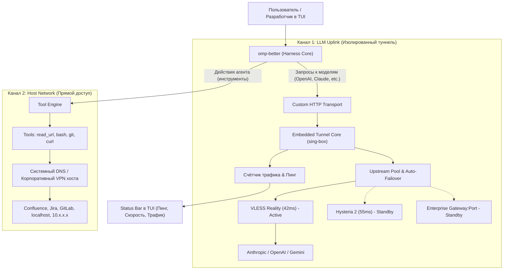

# План-роадмап проекта `omp-better` (Go)

> **Миссия**: Создать быстрый, легковесный агентный терминальный харнесс на **Go** с изолированным «невидимым» туннелем для обращений к LLM, полной защитой корпоративного Split-DNS (Confluence/Jira/GitLab работают напрямую) и встроенной телеметрией сетевого канала.

---

## 1. Архитектурная концепция: Двухканальная сеть (Split-Networking)



---

## 2. Структура проекта (Go)

```
omp-better/
├── cmd/
│   └── omp/
│       └── main.go              # Точка входа: CLI-флаги, запуск TUI и харнесса
├── internal/
│   ├── config/
│   │   ├── config.go            # Структура omp.yaml / omp.json
│   │   └── loader.go            # Валидация и загрузка настроек
│   ├── tunnel/                  # Подсистема изолированного туннеля
│   │   ├── engine.go            # Управление жизненным циклом (старт/стоп embedded ядра)
│   │   ├── upstream.go          # Пул узлов, фоновый ping/healthcheck, failover
│   │   ├── metrics.go           # Метрики: скорость (KB/s), total bytes, latency
│   │   └── transport.go         # http.RoundTripper для LLM-клиента
│   ├── llm/                     # Взаимодействие с LLM
│   │   ├── client.go            # Универсальный клиент (Anthropic, OpenAI, OpenRouter)
│   │   ├── stream.go            # Парсер SSE-стриминга с замером TTFT
│   │   └── types.go             # Модели сообщений, промптов, токенов
│   ├── agent/                   # Ядро рассуждений и цикл выполнения
│   │   ├── loop.go              # Цикл: Thought -> Tool Call -> Result -> Response
│   │   ├── context.go           # Управление историей, компрессия контекста
│   │   └── env.go               # Чистое окружение (полное сокрытие прокси)
│   ├── tools/                   # Инструменты агента (Host Network & Direct DNS)
│   │   ├── registry.go          # Реестр и схемы тулов (JSON Schema)
│   │   ├── web.go               # Чтение url (с уважением к корпоративным доменам)
│   │   ├── file.go              # Чтение, запись, Hashline-редактирование файлов
│   │   ├── search.go            # Поиск по кодовой базе (glob, ripgrep)
│   │   └── bash.go              # Выполнение команд шелла с чистым env
│   └── tui/                     # Терминальный интерфейс (Bubble Tea / Lipgloss)
│       ├── model.go             # Главная модель TUI
│       ├── view.go              # Рендеринг чата, карточек тулов, подсветки diff
│       └── statusbar.go         # Живая плашка: статус VPN, пинг, скорость, модель
├── configs/
│   └── omp.example.yaml         # Пример конфигурационного файла
├── go.mod
└── go.sum
```

---

## 3. Фазы реализации (Roadmap)

### Фаза 1. Ядро сетевого туннелирования и Auto-failover
> **Цель**: создать модуль `internal/tunnel`, который поднимает туннель, переключает ноды при сбое и отдаёт `http.Client`.

- [x] **1.1. Парсер конфигураций**:
  - Поддержка `vless://...`, `hy2://...`, `wg0.conf` / ключей WireGuard.
  - Поддержка subscription-based URLs (plaintext и base64) с пулом соединений.
  - Поддержка Enterprise-режима: `http(s)://host:port` с опциональным `bearer_token` / Basic Auth.
- [x] **1.2. Встроенный Tunnel Runner**:
  - Интеграция `sing-box` core в headless/user-space режиме (слушает только эфемерный `127.0.0.1:<random_port>`).
  - Никаких системных TUN-интерфейсов, никаких требований прав администратора.
- [x] **1.3. Upstream Manager & Auto-Failover**:
  - Background healthcheck: периодический HEAD-запрос к canary-эндпоинту каждые $N$ секунд.
  - Определение деградации/таймаута канала и моментальное переключение на следующий узел в пуле.
  - Стратегии выбора: `failover` (по списку приоритетов) или `lowest_latency` (по лучшему пингу).
- [x] **1.4. Модуль метрик**:
  - Атомарные счётчики: байты In/Out, текущая пропускная способность (KB/s).
  - Экспозиция метрик через потокобезопасный API для TUI.

---

### Фаза 2. LLM Gateway & Замер Latency vs TTFT
> **Цель**: связать туннельный клиент с реальными LLM-провайдерами и научиться точно профилировать задержку.

- [x] **2.1. Провайдеры LLM**:
  - Интеграция с клиентами: Anthropic API (Claude), OpenAI API, OpenRouter, Google Gemini через хук `setLlmTunnelProxy`.
  - Привязка HTTP-транспорта строго к локальному туннелю.
- [x] **2.2. Замер задержек**:
  - Разделение времени ответа:
    - $T_{\text{network}}$: канареечный пинг через туннель до API / canary эндпоинта.
    - $T_{\text{ttft}}$: замер TTFT (Time To First Token) через стриминговую обёртку `wrapStreamFnWithTunnelTelemetry`.
    - $T_{\text{gen}}$ / Throughput: замер скорости передачи данных и генерации в реальном времени.


---

### Фаза 3. Host-Bound Инструменты (Защита Split-DNS)
> **Цель**: гарантировать, что все действия агента исполняются напрямую в сети хоста и видят корпоративные ресурсы.

- [x] **3.1. Инструмент `read_url` / веб-скрапер**:
  - Использование стандартного системного HTTP-транспорта (прямой системный DNS хоста).
  - Тестирование резолва внутренних имён (типа `http://confluence.corp.local/` или `http://localhost:3000`).
- [x] **3.2. Инструмент `bash`**:
  - Запуск процессов с очисткой системного окружения от `HTTP_PROXY`, `HTTPS_PROXY`, `ALL_PROXY`, чтобы дочерние утилиты ходили в сеть хоста и не галлюцинировали о прокси.
- [x] **3.3. Hashline-редактирование файлов**:
  - Нативный алгоритм поиска по якорям/хешам строк (Rust-ядро `pi-natives`) для надёжного патчинга без сбоев `str_replace`.

---

### Фаза 4. Агентный цикл рассуждений (Agent Loop)
> **Цель**: замкнуть цепочку «пользователь -> LLM -> вызов тулов -> ответ».

- [x] **4.1. Оркестратор шагов**:
  - Обработка tool calls от моделей, запуск инструментов, сбор результатов и возврат модели (встроенный рантайм `omp`).
  - Ограничение глубины рекурсии (safety limits).
- [x] **4.2. Системный промпт и правила**:
  - Агент не имеет в контексте упоминаний о VPN или прокси, фокус только на коде и задачах.

---

### Фаза 5. Терминальный интерфейс (TUI)
> **Цель**: красивый, информативный и отзывчивый интерфейс.

- [x] **5.1. Главное окно**:
  - Стриминг ответа модели Markdown-рендерингом, карточки тулов, подсветка diff.
- [x] **5.2. Информационный Status Bar**:
  - Сегмент `tunnel` в статусной строке: статус, пинг, имя активного узла, скорость передачи.
  - Цветовая индикация состояния: 🟢 Зелёный (OK), 🟡 Жёлтый (Реконнект / Failover), 🔴 Красный (Все узлы недоступны).
- [x] **5.3. Интерактивное управление**:
  - Слэш-команда `/tunnel` (или `/vpn`): интерактивное TUI-меню (переключение активного узла, выбор стратегии, добавление subscription URL или vless ноды, канареечный probe) и интеграция с окном `/settings`.

---

## 4. Конфигурация (`omp.yaml`)

```yaml
# Модель и провайдер
model: "claude-3-7-sonnet"
provider: "anthropic"
api_key: "sk-ant-..."

# Изолированный LLM-туннель (ТОЛЬКО для общения с моделями)
llm_tunnel:
  enabled: true
  strategy: "failover" # "failover" или "lowest_latency"
  health_check_interval: 15s

  # Пул узлов для авто-переключения
  upstreams:
    - name: "vless-primary"
      type: "vless"
      url: "vless://uuid@my-vps.com:443?security=reality&sni=yahoo.com&fp=chrome&pbk=xxx&sid=yyy&type=grpc"
    
    - name: "hy2-backup"
      type: "hysteria2"
      url: "hy2://password@my-vps2.com:443"

    - name: "corp-gateway"
      type: "enterprise"
      endpoint: "10.100.0.5:8080"
      headers:
        X-DLP-User: "kbratanov"

# Настройки среды агента (Host Network)
workspace:
  clean_env: true # вычищать прокси-переменные из шелла агента
  allowed_tools:
    - "read"
    - "edit"
    - "bash"
    - "grep"
    - "web"
```
